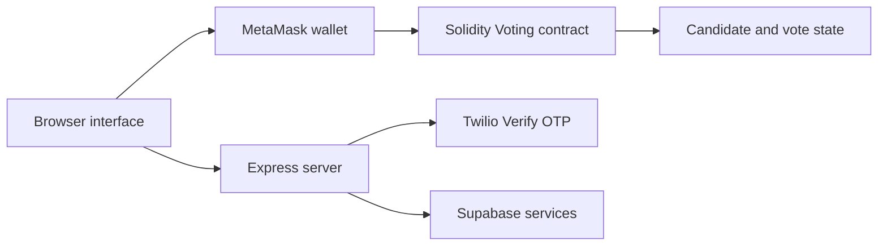

# Blockchain-Based Voting System

**A web prototype that combines a Solidity voting contract with a browser voting interface.**

## Overview

The project includes a Solidity contract for candidate management, one-vote-per-address checks, and vote counts; browser pages for registration, voting, administration, and results; and a Node.js server for OTP endpoints and supporting services. It is a demonstration project and is not a production election system.

## Key features

- Add candidates from the contract owner account and cast a vote from a wallet address.
- Prevent a wallet address from voting more than once in the contract.
- Provide browser pages for voter and administrator flows.
- Include server endpoints for Twilio Verify OTP and wallet funding.
- Store supporting registration and application data through the configured Supabase integration.

## Tech stack

Solidity, JavaScript, HTML, CSS, Node.js, Express, ethers.js, MetaMask, Supabase, and Twilio Verify.

## Architecture and workflow



## Project structure

```text
.
├── contracts/       # Solidity contracts and ABI
├── html/            # Voting, login, registration, admin, and results pages
├── js/              # Browser-side contract and authentication logic
├── css/             # Application styles
├── backend/         # Blockchain and registration helpers
├── scripts/         # Funding helper
├── server.js        # OTP and supporting API routes
├── deploy.js        # Contract deployment guidance
└── SETUP_GUIDE.md
```

## Installation and execution

Requires Node.js and npm. Install packages:

```bash
npm install
```

Configure the environment variables used by `server.js` for Twilio Verify and the optional Supabase and RPC integrations. Keep private keys and service-role credentials out of source control. Deploy `contracts/voting.sol` to a test network using the included setup guide, then configure the deployed contract address and ABI in the client scripts.

Start the OTP server and static frontend together:

```bash
npm start
```

The default static development server serves `html/index.html` on port 3000. Contract interaction also requires a compatible wallet and network.

## Screenshots and demo

No screenshots or hosted demo link are included.

## Author

**Gireesh Sadanand Patgar** · [GitHub](https://github.com/gireeshpatgar17)